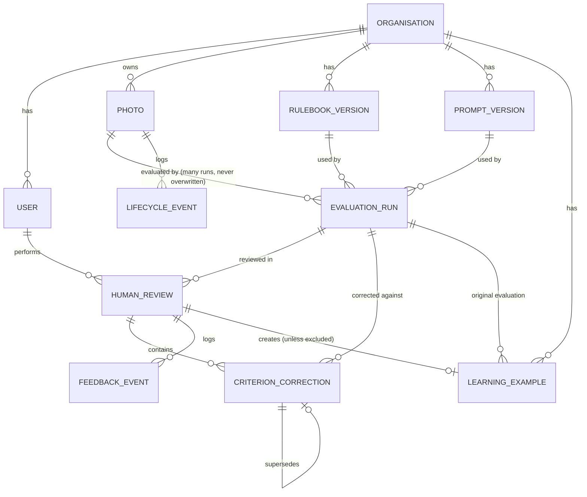

# Phase 2A design: data model, immutability, workflow, access control

## 1. Principles (what the schema is built to guarantee)

1. **Every AI evaluation has a permanent id and is written once.** A human correction is a different record that points at it. Nothing a human does changes what the AI said. This is enforced by database triggers (PostgreSQL and SQLite), not only by application code.
2. **Three different fields, never one:** workflow status (where the photo is in the process), `ai_recommendation` (what the engine said), `human_final_decision` (what the person decided).
3. **The client never supplies the AI's value.** When a reviewer corrects a gate, the server reads `ai_predicted_value` from the stored evaluation; a client cannot claim the AI said something else.
4. **The person's decision is final.** There is no second validation step (removed 2026-11-03 at the project owner's request). The person supports the AI's verdict, or disregards it, and in either case writes the reasons in a text box (compulsory, even when they agree with the AI: it may have missed real points); that submission is the validation. A submitted review becomes a `LearningExample` immediately, created **inactive for retrieval** (activation belongs to Phase 2C).
5. **Policy, perception and preference are kept apart** by the optional reason taxonomy: a review whose reason is `POLICY_CHANGE` or `HUMAN_REVIEW_ERROR` never produces a learning example (a policy change belongs to the rulebook approval process), and neither does an approval over a publication blocker.
6. **Every organisation is a closed world.** Every table carries `organisation_id`; every query is filtered by the caller's organisation; a record of another organisation answers 404, never 403.

## 2. Entity-relationship diagram



## 3. Tables

All ids are UUID4 strings; timestamps are UTC; JSON columns are `JSONB` on PostgreSQL and `JSON` on SQLite.

| Table | Purpose | Key columns | Mutable? |
|---|---|---|---|
| `organisations` | tenant | `organisation_id`, `name`, `configuration`(JSON), `active_rulebook_version_id`, `active_prompt_version_id` | yes (admin) |
| `users` | people | `user_id`, `organisation_id`, `email`(unique), `password_hash`, `role`, `is_active` | yes |
| `photos` | one stored image | `photo_id`, `organisation_id`, `image_storage_path`, `original_filename`, `file_hash`, `uploaded_by`, `uploaded_at`, `event_id`, `capture_date`, `file_format`, `image_width/height`, `photo_status`, `metadata`; **unique (organisation_id, file_hash)** | status only; file fields immutable (trigger) |
| `rulebook_versions` / `prompt_versions` | exact configuration used | `version_id`, `organisation_id`, `version_number`, `configuration`(JSON), `change_description`, `approval_status`, `created_by`, `approved_by`, `created_at`, `effective_at`; unique (org, number) | approval fields only |
| `evaluation_runs` | **one AI evaluation, written once** | `evaluation_id`, `photo_id`, `organisation_id`, `model_provider`, `model_id`, `prompt_version_id`, `rulebook_version_id`, `evaluation_profile`, `raw_response_location`, `validated_response`, `layer_1_output` .. `layer_4_output`, `decision_output`, `ai_recommendation`, `quality_score`, `processing_status`, `input_tokens`, `output_tokens`, `estimated_cost`, `latency`, `content_hash`, `error`, `created_at`, `completed_at` | **filled exactly once** (PROCESSING to AI_EVALUATED or FAILED), then frozen; never deleted |
| `human_reviews` | one person's review of one run | `review_id`, `photo_id`, `evaluation_id`, `organisation_id`, `reviewer_id`, `review_status`, `human_final_decision`, `overall_agreement_with_ai`, `reason_categories`(JSON list), `reviewer_comments`, `idempotency_key`, `reviewed_at`, `created_at`; unique (evaluation, reviewer) for an open review | while IN_PROGRESS; frozen once submitted |
| `criterion_corrections` | one correction of one criterion | `correction_id`, `review_id`, `evaluation_id`, `organisation_id`, `criterion_id`, `criterion_type`, `ai_predicted_value`, `human_corrected_value`, `correction_reason`(JSON list), `reviewer_comment`, `revision`, `supersedes_correction_id`, `created_by`, `created_at` | **frozen**: a changed mind is a new revision, never an edit |
| `feedback_events` | every human interaction, append-only | `event_id`, `organisation_id`, `review_id`, `evaluation_id`, `photo_id`, `event_type`, `actor_id`, `payload`(JSON), `created_at` | never |
| `lifecycle_events` | every system state change of a photo, append-only | `event_id`, `organisation_id`, `photo_id`, `evaluation_id`, `stage`, `from_status`, `to_status`, `payload`, `created_at` | never |
| `learning_examples` | examples made from submitted reviews, for future retrieval | `learning_example_id`, `organisation_id`, `photo_id`, `original_evaluation_id`, `human_review_id`, `verified_decision`, `verified_tags`, `verified_gate_results`, `verified_reasons`, `source`, `active_for_retrieval` (default false), `created_at` | activation flag only (Phase 2C) |

`feedback_events` and `lifecycle_events` are separate on purpose: one is what **people** did, the other is what the **system** did. Together they replay the whole lifecycle in the specification.

## 4. Statuses

* **Photo `photo_status`** (workflow): `UPLOADED, PROCESSING, AI_EVALUATED, PENDING_REVIEW, HUMAN_REVIEW_REQUIRED, REVIEW_IN_PROGRESS, APPROVED, REJECTED, FAILED`. After the AI finishes, the photo moves to `PENDING_REVIEW`, or to `HUMAN_REVIEW_REQUIRED` when the engine itself asked for a person (recommendation HUMAN_REVIEW or RESELECT). `APPROVED` / `REJECTED` mean *a person's final decision has been recorded*. Nothing is published automatically.
* **Evaluation `processing_status`**: `PROCESSING, AI_EVALUATED, FAILED`.
* **Review `review_status`**: `REVIEW_IN_PROGRESS, FEEDBACK_SUBMITTED`.
* There is **no validation status**. A review is `REVIEW_IN_PROGRESS` until it is submitted, and then final. Every decision needs a written reason (at least 10 characters): disagreeing, agreeing, and also when the AI itself asked for a person to decide.
* Separate fields: `ai_recommendation` (APPROVE, APPROVED_PENDING_PUBLICATION_CHECKS, REJECT, HUMAN_REVIEW, RESELECT), `human_final_decision` (APPROVE, REJECT), `overall_agreement_with_ai` (AGREE, DISAGREE, AI_DEFERRED when the AI asked for human review).

## 5. Immutability, enforced in the database

| Table | Trigger rule |
|---|---|
| `evaluation_runs` | UPDATE refused once `processing_status` is `AI_EVALUATED` or `FAILED`; DELETE always refused |
| `criterion_corrections` | UPDATE always refused (a new revision is a new row); DELETE refused |
| `feedback_events`, `lifecycle_events` | UPDATE and DELETE refused |
| `photos` | UPDATE refused when `image_storage_path`, `file_hash`, `organisation_id` or `uploaded_at` would change; DELETE refused |
| `human_reviews` | UPDATE refused once `FEEDBACK_SUBMITTED`; DELETE refused |

Each `evaluation_runs` row also stores `content_hash` (SHA-256 of the canonical JSON of everything the AI produced). `verify_integrity()` recomputes it, so tampering by someone who disables triggers is still detectable.

## 6. Corrections

* A correction targets one criterion: scene fact, activity type, gate, tag, quality dimension, editorial observation, publication item, or the final decision. `criterion_type` is one of `SCENE_FACT, ACTIVITY_TYPE, MANDATORY_GATE, CRITERION, QUALITY_DIMENSION, TAG_ADDED, TAG_REMOVED, EDITORIAL_OBSERVATION, PUBLICATION, FINAL_DECISION`.
* The server resolves `ai_predicted_value` from the stored run. For `TAG_ADDED` the AI value is null; for `TAG_REMOVED` it is the tag.
* Re-correcting the same criterion in the same review creates a **new revision** that supersedes the previous one; both stay.
* The reviewer edits only what is wrong. Criteria with no correction are, by definition, accepted as the AI gave them.
* Reasons come from the taxonomy (12 categories, several allowed per correction) plus free-text comment.

## 7. Versions

`rulebook_versions.configuration` = `{profile, without:[...], rulebook_version, config_digest}` where `config_digest` is the SHA-256 of the rulebook YAML files at registration time. `prompt_versions.configuration` = `{template_version, prompt_hash, profile}`. An evaluation records both ids and the engine's own reported hash; if the hash differs from the registered one the run is stored with a warning. Approval: creator and approver must be different people; only an `APPROVED` version can be activated for an organisation.

## 8. Access control

Roles: `REVIEWER` (view, review, correct, decide), `ORG_ADMIN` (everything in the organisation, plus users, versions and the list of learning examples). There is no validator role. JWT bearer tokens (HS256, short life) carry user id, organisation id, role; the server re-reads the user from the database on every request, so deactivating a user takes effect at once. Cross-organisation access returns 404. Passwords use scrypt. The login endpoint is rate-limited per account and per address in memory (single instance; a shared store is needed for several instances).

## 9. API (adapted from the suggested routes)

```
POST /auth/login
POST /photos/upload                              multipart; stores once per (org, file_hash); starts an evaluation
GET  /photos/{photo_id}  ,  GET /photos/{photo_id}/image
POST /photos/{photo_id}/evaluations              re-evaluate (new EvaluationRun, optional rulebook/prompt version)
GET  /evaluations/{evaluation_id}
POST /evaluations/{evaluation_id}/review         open (or resume) my review of this run
PATCH /evaluations/{evaluation_id}/corrections   add corrections to my open review
POST /feedback/{review_id}/submit                support or disregard the AI; final; idempotent (Idempotency-Key)
GET  /feedback/{review_id}
GET  /organisations/{organisation_id}/feedback
GET  /organisations/{organisation_id}/evaluation-history
GET  /organisations/{organisation_id}/learning-examples      administrators only
GET  /organisations/{organisation_id}/versions ; POST .../versions ; POST .../versions/{id}/approve ; POST .../versions/{id}/activate
```

## 10. Migration plan

1. `0001_phase2a_feedback_infrastructure`: creates all tables, unique indexes, and the immutability triggers for the dialect in use. There is no earlier database, so this migration has no data to move.
2. `0002_remove_validation_workflow` (2026-11-03): users with the VALIDATOR role become REVIEWER; the four validation columns of `criterion_corrections` and `validation_status` of `learning_examples` are dropped (their history is not kept); the immutability triggers are rebuilt so a correction is fully frozen. Downgrade restores the columns with defaults but not their history.
3. `scripts/bootstrap.py` creates an organisation, an admin, and registers the V1 rulebook and prompt versions as `APPROVED` and activates them, and V2 as `DRAFT`.
4. Historical pilot answers (`layered-engine/runs/*/results.jsonl`) can be imported as `EvaluationRun` rows by `scripts/demo_phase2a.py` (offline, no model call) to demonstrate the workflow on real stored output.
5. Future migrations are additive. Phase 2B/2C add tables (annotations, tag taxonomy, embeddings index); none of them needs to alter the Phase 2A tables.
