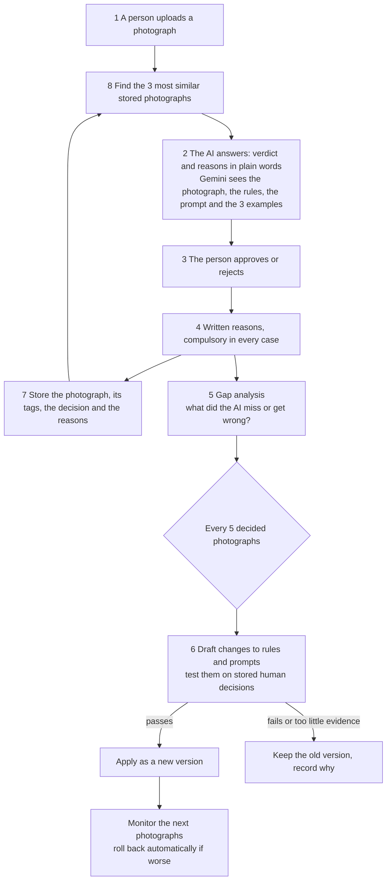

# Learning loop design (version 2, 2026-11-03)

Status: **L1 (compulsory written reason), L2 (the example store), the offline part of L3 (gap analysis) and L4 (the automatic update cycle for settings) are built; the model-based gap analyzer (L3b) is built and tested with a fake model but has never been run on a real model (section 18); L5 (per-decision prompt notes) is designed (section 19) and built with the apply switch off (section 19.1); it has never run on a real model. L6 (the administrator screens) is built.** No model call has been made for any of it.

This version replaces the first draft, which had a person approve every change. The project owner then decided otherwise, and this document follows those decisions.

## 1. Decisions taken by the project owner (2026-11-03)

| # | Decision | Effect on the design |
|---|---|---|
| 1 | The person who inputs the photograph is the approver, and their choice is final. A written reason is compulsory for **every** decision: approve or reject, and even when they agree with the AI, because the AI may not have captured every real reason. | Built. The reason is the main learning signal. |
| 2 | Rules and prompts update **automatically**, with no approval per change. Developers review them periodically. | No approval queue, no NGO sign-off step. Safety comes from automatic tests and rollback instead (decision 7). |
| 3 | No double review of reviewers. | The calibration sample from the first draft is dropped. |
| 4 | No shadow mode. A human decides on every photograph. | A new version applies to the next photograph. |
| 5 | Prompt wording is drafted by a cloud model from anonymised summaries only. | Needs the same explicit cloud authorisation as photo evaluation, and a spend limit. |
| 6 | An update cycle runs **every 5 decided photographs**. | Cycles are frequent, so each must be cheap and must not react to noise (section 5). |
| 7 | The agent may change everything **except the text of the client's 16 rules**. Every update is **tested first on stored human decisions** and **rolled back automatically** if results get worse. | The agent never rewrites the 16 rules; it flags contradictions for developers. |
| 8 | Each new photograph is compared with all stored photographs; the **3 most similar** go to Gemini as examples **with their images, tags, decisions and reasons**, plus the prompt and rules. | Section 4.2. Measured: about 8% more cost per evaluation (section 17). |

## 2. The loop (the owner's eight steps)

A person still decides every photograph. The agent changes how the AI answers next time; it never approves anything.

## 3. What stays fixed, and what the agent may change

**Fixed (the agent can never change these):**
* The wording of the client's 16 rules. If feedback contradicts one, the agent records a *flag for developers* and does nothing else.
* The publication blockers (number plates, manipulation, unsafe activity, degrading representation).
* That Python, not a model, applies the rules and produces the verdict. The model only answers questions about the photograph.
* That a person's decision is final and that nothing is published automatically.
* One NGO's data never changes another NGO's rules or examples.

**Changeable automatically** (each change is a stored, versioned record in the format the V2 work used, so it can be read, tested and undone):

| Class | Examples | How it is tested |
|---|---|---|
| **Examples** | which stored photographs may serve as examples; removing one found to be misleading | by measurement on stored decisions (section 5.3) |
| **Quality scoring** | the six dimension weights and the 85/70/55 band thresholds (currently uncalibrated guesses) | exactly, by replaying stored answers; free |
| **Decision settings** | when a gate applies, exceptions, soft caps (the settings that put the 16 rules into practice, not their wording) | exactly, by replay; free |
| **Prompt wording** | clearer questions, added clarifying text | the model must be asked again, which costs money |

**One safeguard I added, which you can change.** A change that makes the system *looser* (more approvals) is held for developers, not applied, until there is enough evidence to show it does not add false approvals (section 5.3). Changes that make it stricter, or neutral, apply automatically. This costs no approval clicks in the normal case and prevents the one error that really matters.

## 4. The two new parts of the pipeline

### 4.1 Gap analysis (step 5), after every decision
A text-only model compares the AI's reasons with the person's written reasons and records structured gaps:
* **They agree on the verdict:** which points the person gave that the AI did not (a missed reason for approval or rejection).
* **They disagree:** what the AI got wrong, and which gate, rule or scene fact it relates to.
* A reason that adds no information ("looks good") is stored but marked low-information, and carries little weight later.

This needs the same explicit cloud authorisation as other model calls. It sees text only, never the photograph. The cost per decision is small.

### 4.2 Similar photographs as examples (step 8), at evaluation time
* **Finding them:** each stored photograph gets an image embedding when it is decided (DINOv2 and CLIP were already used in the original project; the choice should be measured on the pilot photographs). Similarity is searched **only inside the same NGO**.
* **Which ones:** the 3 most similar photographs that have a final human decision, balanced between approved and rejected when possible so the AI does not simply copy the majority. Never the photograph itself or an exact duplicate. Never a photograph whose review was excluded from learning (a policy-change reason, a self-declared reviewer error, or an approval over a publication blocker). Never one a developer has marked misleading.
* **What Gemini receives:** the new photograph, the rules and prompt, and for each example its image, tags, the human decision and the human's reasons, labelled as *past decisions for similar photographs, for calibration only; answer for the new photograph independently.* Python still applies the rules to the answers.
* **Cost:** measured on 20 pilot photographs (section 17): about 46% more input tokens (7,387 to 10,805) and about 8% more cost ($0.0169 to $0.0183 per evaluation at the placeholder price), because most of an evaluation is the model's own output. An earlier version of this document said "about four times"; that was a wrong estimate.
* **Privacy:** photographs of children and the reviewers' raw reasons are sent to the cloud as examples, and more often than before. They belong to the same NGO and fall under the existing cloud authorisation, but this is wider use than evaluating each photograph once, so the NGO should be told.
* **At the start the pool is empty,** so the system behaves exactly like V1 until decided photographs accumulate.

## 5. The update cycle (every 5 decided photographs)

### 5.1 What a cycle looks at
Every 5 newly decided photographs start a cycle. It analyses **all stored feedback**, not just the last 5, because 5 photographs are too few to show a pattern. A change needs the same gap in at least **3 photographs** (an assumption, to be tuned). A cycle that finds nothing changes nothing, which will be the usual result, especially early.

### 5.2 Drafting
* Scoring and decision settings: drafted by code (a search for the values that fit the human decisions best).
* Prompt wording: drafted by a cloud model that sees the current wording and **anonymised summaries** of the gaps, never photographs and never raw reviewer comments.
* Every draft is checked by code against the "fixed" list in section 3. A draft that touches the 16 rules' wording, a publication blocker or a verdict rule is discarded and logged as a flag for developers.

### 5.3 Testing: "test first" (decision 7)
Tests use the stored human decisions as the truth. The photograph being scored is always left out of its own example set (leave-one-out), so an example cannot give itself away.

* **Settings and scoring: replay.** The engine's existing `redecide` re-applies the rules to the stored answers. Exact, free, repeatable.
* **Prompt wording: ask the model again,** on a bounded sample of stored photographs, **and run the current prompt again on the same photographs in the same cycle (the control)**. The model is not deterministic: on unchanged questions it gave the same answer only 92% of the time (3,174 of 3,450) in the V1/V2 work, so comparing with stored results would credit noise as improvement.

**The change is applied only if all hold; otherwise the old version stays and the reason is recorded:**
1. **No new false approvals.** No photograph humans rejected becomes approved.
2. **Enough evidence.** The test set must contain at least 20 human-rejected photographs (an assumption), because false approvals can only be seen among rejected photographs. With fewer, a looser change is held for developers; a stricter or neutral change may still apply.
3. **A real gain.** It must reduce false rejections or fix the gap it was drafted for, beyond the noise measured by the control.
4. **Within the spend cap** (section 7).

### 5.4 Applying
A passing change becomes a new rulebook or prompt version in the existing version registry. Today the registry demands that an administrator approve a version created by someone else, so it needs one extension: a version can be approved by **"automatic guardrails"** with a link to the test that passed, while the creator (the agent) and the approver stay different. Every change gets a plain-language changelog entry (what changed, why, the evidence, the test result). The previous version is kept.

### 5.5 Monitoring and automatic rollback
After a version is applied, the next 10 decided photographs are watched for the false-approval proxy (the AI approved, the person rejected) and for the disagreement rate, compared with the previous version. If they are clearly worse (thresholds are assumptions to tune), the system **returns to the previous version by itself** and records it. Rolling back restores something already tested, so it is the safe direction. With a human deciding every photograph, the exposure while a bad version is live is limited to a few verdicts that a person then corrects.

## 6. Developer visibility and control

Developers review, they do not approve each change:
* **Changelog:** every version, in plain language, with its evidence and test result, whether it was applied, held, blocked or rolled back.
* **Held for developers:** looser changes without enough evidence, flags where feedback contradicts one of the 16 rules, and drafts that touched something fixed.
* **Controls:** a switch that pauses automatic updates for an NGO; the ability to roll back any version; the ability to mark a stored photograph as misleading so it is never used as an example again.

## 7. Spend

An automatic loop spends money without anyone clicking, so it needs a cap you set first: a monthly limit for the loop's own model calls (gap analysis, wording drafts, wording tests). A ledger records every call. At the cap the loop stops wording tests and wording changes and continues with free work (storing, replay-tested settings). Examples in evaluations (4.2) raise the cost of every evaluation, which the cap does not control; it follows from decision 8.

## 8. Data model additions (new tables; Phase 2A tables do not change)

| Table | Purpose |
|---|---|
| `photo_embeddings` | one image embedding per decided photograph, with the model that made it; scoped by organisation |
| `example_flags` | photographs excluded from use as examples (and why) |
| `gap_analyses` | the structured gaps from step 5 for each decision, including the low-information mark |
| `improvement_cycles` | one run every 5 decisions: trigger, what it analysed, status, model spend |
| `change_records` | one drafted change: class, the change record, evidence references, status (`APPLIED`, `HELD`, `BLOCKED`, `ROLLED_BACK`), reason |
| `change_tests` | how it was tested: method (replay or ask-again with control), numbers, flips, guardrail results, cost |
| `spend_ledger` | every loop model call and its estimated cost, against the monthly cap |
| `loop_settings` | per NGO: cap, thresholds (3 photographs, 20 rejected, rollback margins), pause switch |

Existing tables to extend: version approval gets the "automatic guardrails" approver; the audit trail records who or what applied a version.

Engine change needed: today a change like V2 lives in a YAML profile on disk. The loop needs the engine to accept change records stored in the database on top of a profile, plus wording overrides and the retrieved examples in the prompt. This stays testable against the frozen V1 snapshot test so V1 remains byte-for-byte identical when the loop has changed nothing.

## 9. Risks and what answers them

| Risk | Answer |
|---|---|
| One decision becomes a rule (cycles are only 5 photographs apart) | a change needs the same gap in at least 3 photographs; the cycle reads all history; most cycles change nothing |
| A person agrees with the AI without thinking | the reason is compulsory; generic reasons are marked low-information and carry little weight |
| A wrong human decision becomes an example and spreads | balanced examples; low-information decisions kept out of the example pool; developers can mark an example misleading |
| The AI copies the examples instead of judging the photograph | the prompt says to answer independently; examples are balanced; Python decides from the answers; the effect is measured (section 11) |
| A change that looks better is just model noise | control arm in the same cycle |
| A looser change lets bad photographs through | held for developers unless there is enough evidence; the no-new-false-approvals rule; automatic rollback |
| Too little data for the tests to mean anything | minimum evidence rules; "held", not "applied", is the default |
| The test cheats by using a photograph as its own example | leave-one-out in every test |
| The loop overspends | monthly cap and ledger |
| The NGO is surprised that its settings change automatically | the 16 rules' wording is never touched, but the settings that apply them are; **tell the NGO**, since earlier they asked that no policy change be final without their approval |
| Children's photographs and reasons reach the cloud more often | same-NGO only, existing authorisation, NGO informed (section 4.2) |

## 10. Build order

| Step | Content | Model calls |
|---|---|---|
| **L1** | compulsory written reason on every decision | none. **Done.** |
| **L2** | example store: embeddings, similar-photograph search, example-aware prompt, example flags | none to build. **Built (section 13).** Measuring its effect on the model needs your approval |
| **L3** | gap analysis after each decision | **Offline part built (section 14); model-based part (L3b) built, not yet run (section 18).** Running it on a real model needs your approval |
| **L4** | engine accepts stored change records; the 5-photograph cycle for scoring and settings, with replay tests, changelog, held list, rollback and the pause switch | none. **Built (section 15)** |
| **L5** | prompt wording changes: drafting, ask-again tests with control, spend cap and ledger | yes, capped |
| **L6** | developer changelog screen and monitoring dashboard | none. **Built (section 16)** |

I suggest **L2 first**: it is your step 8, it needs no rule change, and it is the lowest-risk way for the AI to improve. L3 and L4 follow. Each step ends with tests and a demonstration on stored data, as in Phase 2A.

## 11. How we will know it works

* **Examples help, or we find out they do not.** On the 50 pilot photographs, run the evaluator without examples and with 3 examples (each photograph excluding itself), and compare with the human decisions. This was run on 20 photographs for about $0.70 (section 17).
* **Replay known history.** Given the pilot's human decisions, the loop should hold back or block the V2 loosening changes (they raised false approvals from 2 to 6).
* **Planted-error test.** Deliberately corrupt a copy of the feedback (flip decisions, add one-line reasons) and confirm nothing harmful is applied.
* **No-op test.** With no real disagreement the cycle must change nothing.
* **Rollback test.** Apply a deliberately bad version and confirm the system returns to the previous one.

## 12. Assumptions to check

All numbers here are starting assumptions, not measured facts: 3 photographs to justify a change, 20 rejected photographs to test a looser one, 10 photographs of monitoring and its thresholds, the choice of embedding model, and the cost estimates (which use a placeholder price). The first real cycles will likely say "not enough evidence"; that is the correct answer for a small start.

## 13. L2 as built (2026-11-03)

**What exists**
* Each photograph is embedded **locally** when it is uploaded (CLIP ViT-B/32 by default; DINOv2 and a tiny thumbnail embedder are selectable with `AGENT_EMBEDDER`). Weights come from the local cache; nothing is downloaded and nothing is sent anywhere. If a model is not available the photograph simply cannot serve as an example, and uploads and evaluations are never affected.
* Search runs **inside one NGO only**. A photograph can be an example only if a person decided it and its review became a learning example (so policy-change reasons, self-declared reviewer errors and approvals over a publication blocker never are), it is not marked misleading, and the NGO has switched the feature on.
* The most similar **3** (setting `k`, 1 to 5) are chosen, balanced: the best approved and the best rejected are both included when both exist, then the next most similar. They are shown to the model **least similar first, most similar last**, each with its image, the tags a person added, the decision and the written reasons, labelled as calibration only and "answer for the new photograph independently". The staff's text is cut to a bounded length and cannot close its own quotation.
* The evaluation record stores exactly what was shown (photographs, similarity, decision, tags, reasons, the embedding model, the wording version) and that record is part of the evaluation's tamper-evident hash. A run with no examples keeps exactly the hash formula it always had.
* **Off by default.** An administrator turns it on per NGO (`PUT /organisations/{id}/few-shot`) and must confirm that each evaluation carries three more photographs (about 8% more cost) and sends past photographs and reasons to the model. Turning it on makes the NGO's existing examples retrievable; turning it off withdraws them. Administrators can mark a photograph misleading (append-only) from the review screen.
* `GET /photos/{id}/similar` shows which past decisions would be used; the review screen lists the ones the AI was shown, with thumbnails and reasons.
* With the feature off, or no eligible example, the request to the model is exactly what it was before (checked by test, and the frozen V1 test still passes).

**What was measured (free, local, 50 pilot photographs)** `scripts/measure_embedders.py`: does the nearest neighbour have the same staff decision? CLIP 68% (95% interval 54-79%), DINOv2 50% (37-63%), the thumbnail 60% (46-72%), chance 50%. **Every interval includes chance**, so no embedder is shown to beat guessing, and the choice of CLIP rests on a difference that is not significant (it is also smaller and faster). This makes sense: whether staff approve a photograph depends on details such as hidden faces, not on how much it resembles another photograph. So the value of the examples is not that similar photographs share a decision; it is that they show how staff reasoned in a similar situation, and that has **not yet been measured on the model**. The with and without examples comparison (about $3.40 at the placeholder price) still needs your approval, and more staff-decided photographs would narrow the intervals.

**Decisions I made that you may want to change**
* `min_similarity` defaults to 0 (no floor). A floor needs data to set; CLIP similarities are compressed (a random pair averages 0.62, the median nearest neighbour is 0.79).
* "Staff tags" are only tags a person added; the AI's own observations that nobody removed are not passed off as staff tags.
* The examples are ordered with the most similar last, next to the new photograph.
* Examples are compared in Python against every eligible stored embedding (fine for thousands of photographs); a vector index is the next step for a large archive.

**Not built yet:** the low-information-reason filter (needs L3), measuring the effect on the model, and a screen for the on/off switch (it is an API call for now).

## 14. L3 as built: the offline part (2026-11-03)

**What exists**
* After each decision is committed, a gap analysis runs in the background (`gap_service.py`). It can never change or block the decision: if it fails, a FAILED row records only the error type. Results are append-only, one row per review and analyzer (`gap_analyses`); administrators list them at `GET /organisations/{id}/gap-analyses`, and the reviewer sees what the agent noted under their decision.
* The analyzer receives **text only**: the AI's verdict, reasons, failed or uncertain gates with their evidence and its observations, and the person's reason and correction comments, with e-mail addresses, web links and phone numbers removed first. No photograph, ever. It is a pluggable `GapAnalyzer`.
* The **baseline analyzer** works offline with no model and no cost. It finds sentences of the person's reasons that the AI's own text does not cover ("a point the AI did not mention") and, when the person disagreed, links sentences to the AI's failed or uncertain gates by shared words ("a contested gate").
* **Generic reasons are marked.** A reason with fewer than three different content words ("looks good to me", "ok") is *low information*: the decision still stands and the feedback is stored, but the example is **never shown to the model**, and the person is told after deciding that specific reasons teach the AI more. It is a plain word check and can be wrong either way; it never blocks a decision.

**What the baseline cannot do (seen in the demo)** It is a keyword heuristic. It does not understand meaning or negation. In the demo a person wrote "the person is in the background and is not a featured beneficiary", which really contests the face gate, but shares no words with the AI's evidence, so it was recorded as a missed point instead of a contested gate. For a disagreement it also cannot tell *why* the person disagrees. It gives the learning loop something countable (how often each gate is contested, which reasons the AI never mentions), but its links to gates are unreliable. **L3b**, a text-only model analyzer, is meant to replace it, and needs your approval for the model calls, a spend limit, and the NGO's authorisation for sending staff text to a model.

**Not built (when this section was written; L3b was built later, section 18):** the model analyzer, a spend ledger, and any use of the results to change rules or prompts (L4).

## 15. L4 as built: the automatic update cycle for settings (2026-11-03)

**What it can change.** The engine now accepts an *overlay*: stored change records applied on top of a profile (`layered_engine.rulebook.OVERLAY_KINDS`). They can change only the quality thresholds, the quality weights, and whether a gate rejects by itself (hard) or only lowers one quality dimension (soft). They cannot touch the wording of a rule, the questions the model is asked (the prompt is always built from the profile without the overlay, so its hash never moves, and a test checks that a run under a changed version raises no prompt-hash warning), publication blockers, or which rules exist. With no overlay everything is byte-for-byte what it was (the frozen V1 test passes) and the shared configuration is never edited.

**The cycle.** An administrator turns the loop on once for an NGO (`PUT /organisations/{id}/learning-loop`, with `confirm_automatic_changes: true`: settings then change by themselves, tested first and rolled back if worse; **tell the NGO**). It is **off by default**. After every 5 newly decided photographs (setting `every_n`), and whenever an administrator runs one (`POST .../learning-loop/run`), a cycle:
1. **Watches the last applied change** (see below) and rolls it back if it is doing worse. If it rolled back, the cycle ends there.
2. **Builds the dataset**: the usable staff decisions (the latest learning example of each photograph, so decisions made over a publication blocker, for a policy-change reason or called a mistake are not used) with the answers the model gave. A fixed 40% of photographs (a stable hash) are **held out**: drafting never looks at them. Reasons too generic to teach anything are not used for drafting but still count as a staff decision when testing.
3. **Drafts changes** by counting and searching, with no model: *soften* a gate that alone rejected at least 3 photographs staff then approved (in at least 80% of them) (loosening); *harden* a soft gate that failed on photographs staff then rejected (tightening); and search the review and reselection thresholds for the setting that removes the most errors on the drafting photographs with no new false approval.
4. **Tests each change by replay** on the stored answers (exact for settings, free), and applies it only if every guardrail holds:
   * it would not approve a single photograph staff rejected, on all stored decisions;
   * it removes at least `min_gain` errors on the held-out photographs;
   * if it loosens anything (more approvals), the held-out photographs must hold at least 20 staff-rejected photographs to show it is safe, or it is **held for developers**, not applied (too little data means "not proven safe").
5. **Applies at most one change per cycle**, as a new rulebook version (the previous overlay plus the change) approved by "automatic guardrails" with a link to its test, and activates it; a passing change that was not applied is tested again next cycle. Every change gets a plain-language changelog entry (`GET .../changelog`, `?status=HELD` for the held list) with its evidence, its test and its history.
6. **Watches it afterwards.** Each later photograph evaluated under the new version is also decided as the previous version would have decided it (an exact comparison on the same stored answers). One new false approval, or clearly more errors, **rolls the change back by itself** (the previous version becomes active), and a rolled-back change, or one a person rolled back (`POST .../changes/{id}/rollback`, latest applied change only, a reason is required), is never drafted again. After the monitoring window the change is confirmed.
A **pause switch** stops everything. The loop never raises into the people deciding photographs: a failing cycle is recorded as FAILED.

**Tested.** Each guardrail, the rollback, the one-change-per-cycle rule, the 5-photograph trigger, the pause switch, the confirmation, organisation isolation and append-only storage have tests; 10 deliberate breakages of the safety rules were each caught (two needed new tests first). A planted-errors test (staff decisions unrelated to anything the AI saw) changes nothing. The migration test walks all five revisions up and down on SQLite and PostgreSQL.

**What it did on the real pilot** (`scripts/replay_pilot_changes.py`, `tests/test_loop_pilot.py`; 50 photographs, 25 approved and 25 rejected by staff; V1 approved 2 that staff rejected and did not approve 21 that staff approved):
* Softening G017 (the kind of change V2 made) is **blocked**: it would approve 1 photograph staff rejected, although it helps on the held-out ones.
* Softening G015, G016 or G018 on their own is **blocked for no measurable gain** (held-out errors 11 to 11).
* Left to itself the loop drafted one change from the pilot, raising the review threshold to 85, and **blocked** it for no gain. It found no gate pattern.
* So on the pilot the loop changes nothing, which is the right answer for 50 photographs, and it would have held back the V2 loosening.

**Limits, plainly**
* **Its knobs cannot fix the main problem.** The 21 approved photographs V1 does not approve mostly fail several face gates at once, so a single-gate softening rarely helps (a gate has to be the *only* failure). Fixing that needs changes the loop cannot make: how the gates apply (an NGO policy decision), or the questions the model is asked (L5, which needs model calls). The loop can currently draft only single-gate and threshold changes, not multi-gate or applicability changes, and does not yet draft weight changes (the engine supports them).
* **Small data.** The held-out photographs are the same ones every cycle, so many candidates tested against them can find a lucky one; the evidence rule for loosening (20 staff-rejected held-out photographs) is the main protection and is an assumption to revisit. The thresholds in the table above (3 photographs, 80%, 40%, monitoring window, error margin) are starting assumptions, not measured values.
* **Staff decisions are the truth it learns from**, and staff see the AI's verdict before deciding, so they may be anchored by it. There is no second check of a reviewer.
* **No screen yet**: the loop is driven through the API (the developer changelog and monitoring screens are L6). The cycle is tested with the work run inline; the background-task path uses the same function but is not separately tested.
* **Not built:** L3b, L5 and L6, and any change to prompts or to the wording of rules.

## 16. L6 as built: the administrator screens (2026-11-03)

**Where.** A "Learning loop" entry appears in the header for administrators only (`static/admin.js`; the server enforces the role on every call, and a reviewer who calls the same endpoints gets 403). It has three tabs, all plain text with no markup insertion and no inline script or style, like the rest of the interface:
* **Overview.** Whether the loop is on, paused or off, how many photographs are decided, which settings are active and which learned changes are in force. Controls: *Turn on* (after ticking that settings will change automatically, tested first and rolled back if worse, with no approval for each change, and that the NGO has been told), *Pause* and *Resume*, *Run a cycle now*, *Turn off* (changes already made stay in place). A form for all ten settings. A table of the recent cycles with what each one did (usable decisions, what it watched, each draft and whether it passed, was held or blocked, what was applied).
* **Changes.** Every change the loop has drafted, newest first, filterable by status (Applied, Confirmed, Held for developers, Waiting for the next cycle, Blocked, Rolled back). Each card says in plain words what changed, why, how many stored staff decisions it was tested on, the staff-rejected photographs it would approve (now and with the change), the staff-approved photographs it would not approve, the held-out errors, and, for a loosening change, how many staff-rejected held-out photographs it needs against how many exist. Held changes are marked "kept for developers"; rolled-back ones show why, on the card. The history of each change is under a fold. **Roll back** (asks for a reason) is offered for the change in force, applied or confirmed; the server refuses it for any other change.
* **Similar-photo examples.** The L2 switch that was an API call until now: on or off, how many examples, a similarity floor, how many photographs are embedded, how many past decisions are usable and how many are marked misleading. Turning it on needs a ticked confirmation of the four-times-larger evaluations and of what is sent to the model.

**Found while building it.** A change that monitoring had *confirmed* could no longer be rolled back by a person, although it was still in force. A person can now undo the latest change in force, applied or confirmed (a test covers it).

**Checked.** The scripts are tested for text-only insertion, no inline script or style, a content-security policy without `unsafe-inline`, fresh caching, and administrator-only data. The screens themselves were then driven in the browser against a demo story (a separate synthetic demo NGO, scenario I of `scripts/demo_phase2a.py`: a change held, applied, rolled back by the loop itself, another confirmed, another held): pause and resume, a cycle run, a rollback with a reason, the held filter, the examples switch with its confirmation, the loop's turn-on confirmation, and that a reviewer sees no administrator navigation.

**Limits, plainly**
* The screen logic has no automated test of its own: the checks above were done by hand in the browser. The tests cover the endpoints and the scripts' safety, not the clicks.
* "Monitoring" is the cycle table and the status of each change (confirmed or rolled back), not charts: it does not plot false approvals over time or per version.
* The gap analyses (L3) and the photographs marked misleading have no list screen (a photograph is marked from its review screen, and the gap analyses are an API list).
* The reason for a rollback is asked with the browser's own prompt box, which is plain.
* The demo's synthetic photographs and its pinned held-out split exist only to make the story repeatable; they are labelled as such, and nothing like them is in the product.

## 17. L2 measured on the model: 20 pilot photographs (2026-11-03)

**What was run** (`scripts/measure_examples_effect.py`; 40 real Gemini calls, $0.703 at the placeholder price, authorised by the project owner). Twenty of the 50 pilot photographs (10 approved and 10 rejected by staff, chosen with a fixed seed) were each evaluated twice, now, with the same prompt, rules and model: without examples (the control) and with the 3 most similar *other* pilot photographs and their staff decisions (balanced between approved and rejected, never the photograph itself; no near-duplicate was among them). Only the example's decision was sent: no tags, and no reasons, because the pilot recorded none.

**Results**
* **Verdicts: nothing moved.** The system approved none of the 20 photographs, with or without examples, so it agreed with staff on the same 10 of 20 (the 10 staff-rejected ones) both times, and did not approve the 10 staff-approved photographs either time. No photograph changed between approved and not approved; no staff-rejected photograph was newly approved. The exact paired test is p = 1.00. The yes/no outcome was stuck at "not approved", so it could not show an effect either way.
* **Recommendations moved on 3 of 20** (REJECT to HUMAN_REVIEW, HUMAN_REVIEW to REJECT, RESELECT to REJECT): in both directions, so no pattern.
* **Individual answers moved only slightly more than noise.** Running the same prompt again moved 5.6% of the model's criterion answers (stored pilot answer against the control); adding examples moved 7.6% (control against examples run). The examples moved more than the noise on 11 of 20 photographs, which is what chance gives.
* **No sign of copying.** The verdict equalled the majority of the three examples on 7 of 20 photographs with examples and on 7 of 20 without them.
* **Cost, measured.** 7,387 input tokens per call without examples and 10,805 with them (+46%); output about the same (5,877 against 6,004); $0.0169 against $0.0183 per call at the placeholder price (+8%). The earlier estimate of "about four times" was wrong, because most of an evaluation is the model's own output.
* **The number of failed gates does not separate staff-approved from staff-rejected photographs on these 20.** Staff-approved photographs failed 4.4 to 4.8 gates on average and staff-rejected ones 3.7 to 4.0, in the stored pilot answers and in both new runs. The chance that an approved photograph has fewer failed gates than a rejected one is 0.44 to 0.47 (95% intervals roughly 0.2 to 0.7; 0.5 is chance). So on this sample the gates do not track what staff decided, with or without examples.

**What this does and does not show**
* It shows **no benefit and no harm** from the examples on this sample, and that the examples do not make the model copy them.
* It cannot show a small effect: 20 photographs and a verdict that never changes. A real effect, if there is one, could only appear in how the model answers individual criteria, and there is no staff label for those, only for the whole photograph.
* The examples here carried no written reasons, which the live system will have. Reasons might help more; this test cannot say.
* **The larger finding is about the rules, not the examples.** The system's approval depends on gates (mostly the face gates) that staff-approved photographs fail as often as rejected ones. Showing similar past decisions does not change that, and neither can the loop's settings (section 15). It is a question of what the NGO's rules mean in practice, which only the NGO can settle.
* The test is small and was run once; the 7.6% against 5.6% difference between "examples" and "noise" is within what chance gives.

## 18. L3b as built: the model-based gap analyzer (2026-11-03)

Status: **built and tested with a fake model; no real model call has been made.** The offline keyword analyzer (section 14) remains the default.

**What it is.** `llm_gap_analyzer.py`: `LlmGapAnalyzer` (name `llm-gap-1`) implements the same `GapAnalyzer` interface as the baseline, so the rest of the platform did not change. For one decision it sends a language model a text-only request: the gates of the profile (id, rule, whether it can reject, the operational question and the client's verbatim wording), the AI's findings, and what the reviewer wrote (reason and correction comments). It returns structured points, each with a **relation** (the reviewer disputes an AI finding, makes the same point, or raises something new), the **gates and rules** concerned, a one-line **rule note** comparing the reviewer's view with what the gate or client wording says, and a confidence. Stored kinds: `CONTESTED_GATE`, `CONTESTED_POINT` (a dispute not tied to a gate), `MISSED_POINT`, `CONFIRMED_POINT`. The meaning is read by the model, not matched by shared words, so it can tell that "the faces are visible" disputes "the faces are not visible".

**What it never does.** It does not decide a photograph, does not change a rule or setting, and does not draft changes (that is L5). A failure or bad answer is stored as a FAILED analysis and the decision stands.

**What Python checks.** The answer must be JSON of the expected shape (otherwise the analysis fails with `ModelOutputError`); a point with an unknown relation or no summary is dropped; gate ids not in the rulebook are removed (so it can never point at a gate that does not exist); at most 8 points, 3 gates per point; summaries and notes are cut to length.

**Untrusted text.** The reviewer's words and the AI's findings (which may include text read off a banner) are placed between tags; the model is told they are data and never instructions; a forged closing tag is turned into plain brackets; one field is cut at 4,000 characters; contact details were already removed; no photograph is sent.

**Spend.** A generic or empty reason is not sent at all (nothing to learn, nothing to pay). An optional per-process call limit (`max_calls`) stops a runaway; it is not a monthly cap, which is still to be set. The cost of each call is stored with the analysis from the placeholder price list and counts input and output tokens only, so the model's own thinking tokens are not included and the figure may be low (the same is true of the photograph evaluator's estimate).

**Wiring (all off by default).** The engine's `GeminiProvider` gained `complete_text` (text-only; same authorisation switch, key scrubbing and retries as photographs; the retry loop was moved into a shared `_generate` with no change to what `assess` sends). The platform reads `AGENT_GAP_ANALYZER=baseline|llm` and `AGENT_GAP_MAX_CALLS`; `scripts/serve_fresh.py` takes `--live --llm-gaps [--gap-max-calls N]`. Results of the two analyzers are separate rows (one per review and analyzer), so switching does not rewrite history.

**Tests.** 19 platform tests and 1 engine test, all with a fake model; seven deliberate breakages of the rules above were each caught.

**Not done, and needed before use.** (1) Your approval for the first real run and a spend cap; (2) telling the NGO that reviewers' written reasons are sent to the cloud as text; (3) a measurement of its quality on real decisions (for example whether its gate mapping agrees with a person's); (4) nothing yet uses these records: the update cycle still works from approve/reject decisions only, and drafting changes from them is L5.

### 18.1 The Groq adapter (2026-11-03)

Status: **built and tested against a fake HTTP transport only; nothing has been sent to Groq.** The `.env` does not yet contain the Groq switch or key, so it cannot run.

**What it is.** `groq_text_model.py`: `GroqTextModel`, a second implementation of the analyzer's `TextModel` interface, over Groq's OpenAI-style chat API (`https://api.groq.com/openai/v1/chat/completions`, via `httpx`). The analyzer, its prompt, its checks and what is stored are the same as for Gemini; only the model behind it differs.

**Its own authorisation.** It refuses to start unless `NGO_ALLOW_GROQ_INFERENCE=true` and `GROQ_API_KEY` are set (optional `GROQ_MODEL`; default `openai/gpt-oss-120b`, not yet confirmed to be available to a key). It never uses the Gemini switch, because Groq is a different company and the NGO's approval for Google does not cover it. The key is read into memory only and never appears in a log or an error message (an echoed key in a Groq error is scrubbed).

**JSON answers.** Models listed as supporting constrained decoding (`openai/gpt-oss-20b`, `openai/gpt-oss-120b`, per Groq's documentation) get a strict JSON schema (objects closed, every property required, length keywords removed; the analyzer applies the caps itself). If Groq refuses that schema (HTTP 400) the request is repeated once in plain JSON mode with the schema in the instruction, and that is remembered. Other models go straight to plain JSON mode. If an answer is not a JSON object or was cut off, it is asked for once more; after that the unusable text is returned and the analysis is stored as FAILED. Rate limits and server errors (429, 5xx, network failures) are retried with backoff and `Retry-After` (capped at 30 s); 401 and 403 are not retried.

**Cost.** Recorded as zero (free tier) unless per-million prices are passed. Both requests of a retried analysis are counted in the token usage.

**Choosing it.** Production: `AGENT_GAP_ANALYZER=llm` with `AGENT_GAP_LLM=groq` (default `gemini`). Demo: `scripts/serve_fresh.py --llm-gaps --gap-llm groq [--gap-max-calls N]` (Groq needs no `--live`, since the photographs are evaluated separately). Both fail closed if the switch or key is missing.

**Tests.** 22 tests through a fake transport, plus a guard that makes any real network call fail the test; 15 deliberate breakages (including borrowing the Gemini switch, leaking the key, a second retry, ignoring `Retry-After`) were each caught. One timing test was found too weak and made exact.

**Not verified, and needed before use.** (1) A live check: that the default model id exists for the key, that its strict-schema form is accepted (the fallback covers a refusal), and what the free-tier limits really are (third-party summaries of Groq's documentation give about 30 requests a minute, 8,000 tokens a minute and 200,000 tokens a day per model, which would allow roughly 65 analyses a day at about 3,000 tokens each; check the account's limits page). (2) The NGO's approval to send reviewers' written reasons to Groq, and a read of Groq's terms (the sources disagree on exceptions to non-retention and on the training clause). (3) A quality comparison of Groq, Gemini and the keyword baseline on 30 to 50 real decisions whose correct gate and relation a person has labelled; only one real decision with reasons exists so far.

## 19. L5 design: prompt notes updated after every decision (2026-11-03, agreed with the project owner; superseded by section 20 on 2026-11-04)

Status: design only. It supersedes the earlier L5 sketch (batches of 5, a pattern rule, a re-test on stored photographs) where the two differ.

**Decisions of the project owner (2026-11-03)**
1. Update after **every** submitted decision. No grouping or batching of feedback.
2. Model: start with `openai/gpt-oss-120b` on Groq for both mapping and drafting (one data path, one NGO approval); compare it with Gemini on the first 30 or so real decisions; switch only the drafter if its notes are poor.
3. **Do not re-run past photographs** for now. There is no test stage that calls the photograph evaluator again.
4. A note that **loosens a client-sourced gate is applied immediately and flagged** in the developer changelog for review (not held).

**Flow, per submitted decision**
1. The analyst (L3b, built) maps the reviewer's reasons to gates and rules.
2. The drafter (a model, text only) takes each gate the reviewer disputed and fills a closed template: a **setting change** (existing L4 kinds), a **gate note** (short text for that gate, with its direction, loosen or tighten, citing the decision), or **no change / escalate**. Inputs: the gate's question, the client's verbatim wording, this decision's mapped record, and the gate's current note if one exists.
3. Format checks in code: the note concerns only its own gate; it may not mention other gates, the output format or the rules; no instruction-like text copied from the reviewer; a length cap; a cap on the total number of notes. Decisions the reviewer called a mistake, made for a policy-change reason or with a generic reason are excluded, as for examples. A note that contradicts the client's verbatim wording is not applied (the 16 rule texts never change): it is held for developers. How that contradiction is detected (the drafter's own flag plus a second, cheap text check) is to be evaluated.
4. Apply: the note is added to the prompt as a new prompt version (the fingerprint changes; the frozen original stays available). Each gate has one note, which a new decision on that gate revises or replaces, so notes do not pile up. Loosening a client-sourced gate is applied and marked FLAGGED FOR REVIEW. Setting changes keep the L4 guardrail that costs nothing: replay on the stored answers (no model call) and refuse any change that creates a false approval.
5. Watch: for photographs where a note's gate matters, compare how often reviewers override the AI before and after the note; withdraw the note automatically if overrides rise by more than a margin over a window (parameters to be set, in the same style as the L4 settings). A person can withdraw any note with a reason.
6. Controls: off by default (turning it on needs a confirmation that the NGO has been told), a pause switch, every note and withdrawal in the administrator changelog with the decision that caused it.

**Why this is acceptable now, and when it stops being.** A person decides every photograph and nothing is published automatically, so a bad note can only make the AI's advice worse. If the AI is ever allowed to approve on its own, per-decision notes without a test become unsafe and the test stage (re-evaluating stored photographs under a spend cap) must come back first.

**What is given up**
* The pattern rule (at least 3 photographs and 2 reviewers) and the 20-photograph evidence rule for loosening: one reviewer's habit can change the AI's advice until the watch withdraws it.
* Testing a prompt note before it is live; it is judged afterwards by overrides.
* Comparability with the frozen pilot results: every note moves the prompt fingerprint.

**Cost.** One text call per disputed gate per decision (well under a cent on Gemini at the placeholder price; free on Groq within its limits); no photograph re-evaluations; no test ledger. The test stage can return later as an optional switch.

**Not decided yet.** The watch window and margin; whether the drafter also sees the current note's earlier supporting decisions; the exact contradiction check; a monthly limit on drafter calls.

**Before building.** The analyst's gate mapping has not been measured on real decisions (one real decision with reasons exists), and the model for drafting has not been compared. The NGO must be told that reviewers' reasons go to the cloud and that notes change the AI's instructions automatically. A reasonable first build keeps the apply switch off, so drafts are stored and visible to developers before any note goes live.

### 19.1 L5 as built (2026-11-03)

Status: **built and tested with fake models only. Off by default. No real model call has been made for it and it is not switched on for the demo instance.**

**What exists**
* **Engine.** `build_prompt(..., notes=)` adds the notes as section E2 ("Notes from this NGO's reviewers") and the prompt hash moves **only** when notes are present; the frozen V1 hash `11427c79d96c569a` is unchanged (tested). A note for a gate the profile does not have is ignored, and a newline in a note cannot start a section of its own.
* **Data.** Migration 0006: `note_drafts` (what the drafter proposed for one gate after one decision, with its checks and the mapped record it came from) and `note_events` (the append-only status history: DRAFTED, REJECTED, HELD, NO_CHANGE, APPLIED, CONFIRMED, SUPERSEDED, WITHDRAWN). Both are covered by the immutability triggers. Migration 0005 now installs only the triggers of the tables that exist at its revision.
* **Drafter** (`note_drafter.py`). A closed template: `GATE_NOTE` (with LOOSEN or TIGHTEN), `SETTING_SUGGESTION`, `NO_CHANGE`, `ESCALATE`, plus the drafter's own flag that the note would contradict the client's wording. `check_note` is a pure function: not empty, within the length limit (default 300), no other gate, no rule number, no markup, brackets or link, one paragraph, nothing that reads like an instruction to the evaluator (ignore, override, always, answer YES, JSON, ...). The text the model reads sits between tags, forged tags are defused, and an optional call limit stops a runaway.
* **Service** (`note_service.py`). After each submitted decision, once the model-based gap analysis has mapped the reasons, it drafts for the gates the reviewer disputed: only mappings of HIGH or MEDIUM confidence (a LOW one is a guess), at most two gates per decision, only from decisions that made a learning example and were not too generic. Modes per organisation: **OFF** (default), **DRAFT_ONLY** (drafts stored and visible, nothing reaches the prompt) and **APPLY**. In APPLY a draft that passes every check becomes a new prompt version (the base prompt plus the notes; reused if that set of notes existed before) and is used from the next evaluation, which records the prompt version it used. One note per gate (a newer one replaces the older and the older is SUPERSEDED), an identical note changes nothing, and at most `max_notes` (default 5) are in the prompt; the overflow is HELD. A note that LOOSENS a gate taken from the client's own rules is applied and FLAGGED FOR REVIEW. HELD for developers and never applied: a note the drafter says contradicts the client's wording, an ESCALATE, a SETTING_SUGGESTION, and the overflow. REJECTED and recorded: a note that fails a check, or a drafter that fails (only the error's type is kept, never its message).
* **Watch and withdrawal.** For photographs where a note's gate mattered (the AI failed it or could not tell), the share of decisions the reviewer overrode is compared before and after the note, from stored evaluations and reviews (no model call). Under the settings (window 10 decisions, at least 5 before, margin 25 percentage points) a note is withdrawn automatically when the share rises by the margin or more, and CONFIRMED when it does not. With too few decisions before the note to compare against, it gets no verdict and stays applied. A person can withdraw any note, with a reason; withdrawing the last one restores the base prompt version.
* **Controls.** Administrator-only API (`GET` and `PUT /organisations/{id}/prompt-notes`, `POST .../{draft_id}/withdraw`) and a "Prompt notes" tab in the Learning loop screens. Raising the mode needs `confirm_ngo_informed` (reasons go to a cloud model as text; in APPLY the AI's instructions also change automatically); a pause switch; a deployment with no drafter cannot turn notes on (HTTP 409). Wiring: `AGENT_NOTE_DRAFTER=llm` (needs `AGENT_GAP_ANALYZER=llm`) and `scripts/serve_fresh.py --llm-gaps --llm-notes`.

**Where it differs from the design above**
1. A `SETTING_SUGGESTION` is stored and HELD, not applied: the update cycle (L4) stays the only thing that changes settings, so there is no second path that replays stored answers.
2. The contradiction check is the drafter's own flag only; the second, separate check is not built.
3. LOW-confidence mappings are never drafted from, and at most two gates per decision are drafted for. These two limits are mine, to bound cost and guesswork.
4. The watch parameters are starting assumptions, not measured.

**Tests.** 69 platform tests and 4 engine tests, all with fake models. 30 deliberate breakages of the rules above (the switch, the flag, holding contradictions, the cap, replacing notes, confidence, the watch, withdrawal, the confirmation, each check on a note, forged tags) were each caught. Full suites: platform 221 passed, engine 180 passed. The administrator tab has no automated test; it was checked by hand against a throwaway server with fake models.

**Not verified.** How good real drafted notes are; whether Gemini follows section E2 and how it changes its answers; whether notes accumulate sensibly; the watch defaults. Before use: the NGO must be told, the analyst's mapping measured on real decisions, and the first real run approved and watched.

## 20. L5 as the project owner now wants it: the rules themselves are rewritten (2026-11-04)

**The decision.** On 2026-11-04 the project owner changed the L5 design: *everything is mutable*, the client's 16 rules and all 127 rules and 18 gates included. "The AI's verdict is matched with the human's verdict and reasoning; the relevant rules are compared; whichever rule has a disagreement is analysed by the open model and updated. That's it." Notes added to the prompt (section 19) were not what was meant: the **rule itself** is rewritten. This supersedes section 19's "a note that contradicts the client's wording is held" and its "the client's rule text never changes". What stays: a person decides every photograph; Python checks every draft; every applied rewrite is watched and withdrawn automatically; loosening a gate that can reject is flagged for developers; it is off by default; the NGO must be told.

**The flow, per submitted decision** (`rule_service.py`):
1. The AI's verdict is matched with the person's verdict and written reasons (as before: the model-based gap analysis, text only).
2. The analyst now ties each point of disagreement to **the rules it is about**, not only to gates: it is shown every rule the prompt shows (the 82 questions the AI answers, the scene facts, the client's 16 rules), with the gate built on each, and the other rules the AI failed or doubted on this photograph. It names rule ids (`related_criteria`); Python keeps only real ones (`targets`, at most 3 per point; a gate's own rule comes first). A contradiction tied to a rule but no gate is a `CONTESTED_RULE`.
3. For each rule the reviewer disagreed with the AI about (relation CONTRADICTS_AI, confidence HIGH or MEDIUM, from a decision that made a non-generic learning example, at most 2 rules per decision) the open model (Groq `gpt-oss-120b`; the drafter reuses the analyst's model) is shown the rule's current wording, the original wording, the client's wording where there is one, what the AI said about it and the mapped record of the reviewer's reasons, and either rewrites the wording (`UPDATE_RULE`, with `LOOSEN`, `TIGHTEN` or `NEUTRAL` and its own statement that a YES still means the requirement is met) or leaves it (`NO_CHANGE`).
4. Python checks the rewrite (`check_wording`, pure): not empty, within the length limit (default 600) and not far longer than the current wording, no other rule's or gate's id, no markup, brackets or link, one paragraph, nothing that reads like an instruction to the evaluator, and **a question stays a question**.
5. In APPLY mode a rewrite that passes becomes a new prompt version: the same prompt with that rule's wording replaced. The rulebook files are never edited, so the original is always there; the rewrite is stored per organisation (`PromptVersion.configuration["rule_text"]`) and the prompt hash moves only when a rewrite is present (the frozen V1 hash is unchanged; tested). Each rule has one current wording (a newer one supersedes the older), at most 20 rules carry a rewrite (the overflow is HELD for developers).
6. **Flags, not holds.** A rewrite that loosens a rule behind a gate that can reject, or that changes a rule from the client's own document (a client-derived question or the client's text itself), is applied and flagged `FLAGGED_FOR_REVIEW` for developers.
7. **Watch.** As for notes: for photographs where the rule mattered, the share of decisions the reviewer overrode is compared before and after the rewrite (window 10, at least 5 before, margin 25 points); the rewrite is withdrawn automatically when the share rises, confirmed when it does not, no verdict when there is nothing to compare with. A person can withdraw any rewrite with a reason; the rule then goes back to its original wording.

**What can be rewritten:** every rule the prompt shows: the questions the AI answers (82 in the proposed profile), the scene facts it reports (15), the client's 16 rules as shown to it (section C) and, since 2026-11-04, the team's guidance statements (section E, ids GUIDE_01 to GUIDE_04; 117 rules in all). The guidance lines were added after a real failure: the gaze question and the client's R004 text had been rewritten to allow a direct look while receiving an item, but section E still said "A beneficiary looking straight into the camera IS a violation, with no exception for now", and the AI obeyed that line, so the gaze gate kept failing photographs the reviewers had said were fine. A rewrite of one place in the prompt can be defeated by a contradicting statement elsewhere; there is still no automatic check for such contradictions. It does **not** yet cover the quality-dimension labels, the visual flags or the publication blockers (they come from other configuration files), and it does not change how strict a gate is: whether a gate can reject (hard or soft) stays with the L4 update cycle, which replays stored answers before changing it.

**Data.** Migration 0007: `rule_edits` and `rule_edit_events` (append-only, covered by the immutability triggers, same shape as notes). **Controls.** `GET` and `PUT /organisations/{id}/rule-updates`, `POST .../{edit_id}/withdraw` (administrators), the "Rule updates" tab (it replaces the "Prompt notes" tab), `AGENT_RULE_DRAFTER=llm` (needs `AGENT_GAP_ANALYZER=llm`) and `scripts/serve_fresh.py --llm-gaps --llm-rules`. Raising the mode needs `confirm_ngo_informed`; a pause switch; a deployment with no drafter cannot turn it on. The notes code (section 19.1) is still in the code base, off, and a prompt version keeps notes and rewrites side by side if both were ever used; nothing uses notes now.

**"This rule was changed earlier" confirmation (added 2026-11-04, owner's request).** When the loop wants to change a rule that already carries a change made after the rulebook was set (a live rewrite, from the loop or from an administrator), it does not apply it: the rewrite is stored with the status `NEEDS_CONFIRM` and the wording in force stays in use. The app then shows a modal card to whoever is signed in (reviewers and administrators; it is checked every 6 seconds and cannot be dismissed without an answer): the rule, when and by whom it was changed before and why, the wording in force, the proposed wording, why it is proposed, and the question "Are you sure you want to change this rule again?". Yes applies it (the earlier wording is SUPERSEDED, the answer is recorded with the person's e-mail, flags as before); No records `DECLINED` and keeps the wording in force (a later decision may ask again). A rule still in its original wording, or whose earlier change was withdrawn, is changed without any card; so is a drafted wording identical to the one in force (NO_CHANGE); drafts-only mode never asks. Endpoints: `GET /organisations/{id}/rule-updates/pending`, `POST .../{edit_id}/answer`. The Decisions screen shows "Waiting for someone to confirm" and "Not changed: someone chose to keep the current wording". This replaces the earlier rule that an automatic rewrite of an administrator's wording was HELD for developers.

**An administrator's own edit (added 2026-11-04).** An administrator can set one rule's wording by hand (`POST /organisations/{id}/rule-updates/manual`, and a "Change a rule yourself" form in the Rule updates tab). It takes effect at once whatever the mode, passes the same checks as a drafted rewrite, is kept in the same history (migration 0008 makes the link to a decision optional for such a row) and then belongs to the administrator: the automatic watch never withdraws it, and a later automatic rewrite of that rule is HELD for developers instead of replacing it. This is the guard against the loop undoing a deliberate wording; the loop's own drafter still needs the fix that stops a dispute about one photograph from rewriting a rule (not built).

**Status (2026-11-04).** The rule rewriting is switched ON (Apply) on the local demo instance only, by the project owner's instruction; it has run on real decisions with Groq `gpt-oss-120b`. Before that it was built and tested with fake models only.

**Risks the owner accepted by this decision, stated plainly.** A rewrite changes what the AI is asked on every later photograph, so a wrong rewrite of a gate's question can create false approvals before the watch notices (the watch needs about 10 decisions where that rule mattered). A model cannot be proved to keep the *meaning* of a question: Python checks form, size and safety, and the drafter states that a YES still means the requirement is met, but meaning is not machine-checked. Safeguards that remain: a person decides every photograph, the flags, the cap of 20 rewritten rules, the automatic withdrawal, and one-click withdrawal back to the original wording.

**Tests.** about 90 platform tests (`test_rule_updates.py`, `test_loop_activity.py`) and 7 engine tests (`test_rule_text.py`), all with fake models. 61 deliberate breakages of the rules above (the switch, the flags, the cap, superseding, confidence and relation filters, the two-per-decision limit, the watch, withdrawal, the confirmation, each check on a wording, the analyst's rule mapping, the prompt sections and hash) were run one at a time: 59 were caught; one (the extra "rule_text" field in the hash) changes nothing because the rewritten text is already in the hash, and one pattern did not match and was re-run with a corrected pattern and caught. A first run left two breakages in place by mistake and was repeated from a clean state with a restore check. Full suites: platform 298 passed, engine 187 passed. The administrator tab has no automated test; it was checked by hand against a throwaway server with fake models.

**Not verified.** How good real rewrites are; whether Gemini answers a rewritten question the way the reviewers intend; the analyst's mapping of reasons to the 117 rules on real decisions (only one real decision with reasons exists); the watch defaults; Groq's model id and strict-schema behaviour live.

## 21. Clubbed reasons on the review screen (2026-11-04, owner's request)

**The problem.** The AI writes one piece of evidence per failed check, so one problem (a toddler whose face is turned away) reached the reviewer as four sentences saying the same thing in different words, and some sentences carried internal ids such as `G001_ACTIVITY_VISIBLE:`.

**What was built** (`reason_summary.py`, `GET /evaluations/{id}/summary`, `clubReasons` in `app.js`). The review screen first shows the AI's findings as before, with internal ids removed. In the background the server asks a model (the same one that reads the reviewers' reasons: Groq `gpt-oss-120b`) to group the findings that make the SAME point about the SAME subject and to write one short plain sentence for each group; the screen then swaps the list for the clubbed one, with "Show the AI's original sentences" one click away. A gate made of several checks is split into its failing checks first, so findings about the same subject can be joined across gates.

**Guarantees, whatever the model answers** (pinned by tests): every finding appears exactly once (one the model leaves out or groups wrongly keeps its original sentence); only findings of the same kind (failed / could not tell) are joined; a finding that stands alone always keeps its own wording; the model's answer must be JSON of the expected shape or the screen shows the original sentences; contact details and internal ids are removed before and after; the text sent is only the AI's own findings (no photograph, no reviewer text), inside tags, with forged tags defused. It is a display aid: it changes no decision and no stored evaluation. The result is kept in memory per evaluation (an evaluation never changes), so each costs at most one call per server run (about 1,000 tokens; Groq's free tier).

**Wiring.** `AGENT_REASON_SUMMARY=llm` (needs `AGENT_GAP_ANALYZER=llm`) and `scripts/serve_fresh.py --llm-gaps --llm-summary`; off by default, and with it off the screen simply shows the findings as written.

**Limits.** A model decides what "the same point" means, so it can occasionally join findings a person would keep apart or miss a repeat; the originals are always there to check. Not covered: publication-blocker lines ("Before publishing: ...") are not clubbed. The tests use fake models; the live behaviour with Groq has not been measured on many photographs.

## 22. Cutting the cost of a photograph: the short answer format (2026-11-04; built, NOT run, NOT tested)

**Where the cost is.** gemini-3.8-flash, measured on the demo: about 7,400 input tokens, 5,500 answer tokens and about 1,500 thinking tokens per photograph. Thinking is billed as output but was not counted by the app, so the real cost was about $0.032 (about Rs 3), not the $0.017 the app showed with its old placeholder prices. About 80% of it is output.

**What was built.**
* `layered_engine/compact.py`: the short answer format. The same questions; the answer keeps only what Python decides from: an explicit status for every decisive criterion (every gate and gate component, every soft-score criterion, and every criterion a soft cap or an active exception depends on; required by the schema, and a missing one becomes CANNOT_TELL, never a pass), the other (diagnostic) criteria listed only when they are not YES (the one place where an omission counts as YES, limited to criteria that cannot reject), a short phrase for every NO and CANNOT_TELL, the scene facts, one number per quality dimension and the visual flags. `expand_compact` turns it back into the full `ModelAssessment`, so nothing downstream changes. Expected output: about 600 tokens instead of about 7,000 (answer plus thinking).
* `build_prompt(..., response_format="compact")`: the prompt drops the subject list, the observation section and the prose instructions for quality grades, and uses `response_rules_compact.md`; the full prompt and its hash are unchanged.
* `generation.thinking` in the config (a level for Gemini 3.5+, a budget for 2.5 models; absent = the model's default) and `evaluation.response_format` (`full` by default).
* Real prices: `layered_engine/costs.py` counts thinking as output and cached input at the cached rate, with a per-model price table in `gemini_config.yaml` (Google's list prices read 2026-11-04; cached rates are third-party figures). Usage now records the cached tokens.
* `scripts/compare_short_format.py`: the comparison on 20 photographs (the 14 decided on the demo, whose full answers are stored and not paid for again, plus 6 labelled photographs), three configurations (3.5 Flash-Lite high image, 3.5 Flash-Lite low image, 2.5 Flash-Lite), a dry run by default, a spending cap. Estimated cost of the run: about $0.16 (about Rs 16).

**Tests (offline, no model called):** `layered-engine/tests/test_compact.py` (23) and `agent-platform/tests/test_short_format.py` (3); full suites engine 210 and platform 363 passed; 20 deliberate breakages of the new rules were each caught (two needed a test that checks each reason for being decisive on its own, because the rulebook covers some criteria twice). The comparison script's dry run lists the 20 photographs and estimates $0.16. **Not done, on the owner's instruction:** no model has been called and the paid comparison has not been run. The live demo is unchanged (it runs the full format) until it is restarted with `response_format: compact`, and a compact run's prompt hash differs from the registered prompt version, so each such run would carry a warning until prompt versions record the format.

**Expected cost per photograph (estimates, Rs at 95 per dollar):** 3.5 Flash-Lite short format about Rs 0.2-0.35 (less if instructions are served from cache), with batch mode (not built) about half; 2.5 Flash-Lite short format about Rs 0.05-0.1. Rs 0.05 is reachable only with the cheapest model class, batch mode or both, if the quality holds.

**Measured on 20 photographs (2026-11-04, owner-approved, $0.271 spent; `reports/short_format_20261104_135902.jsonl`).** Every call answered (60/60).

| Setup | Rs a photo | Answer tokens | Thinking | Cached input | Seconds | Agrees with staff (20) | On the 14 demo photos | False approvals |
|---|---|---|---|---|---|---|---|---|
| Today: 3.8 Flash, full (stored, not re-run) | about 3 | ~5,500 | ~1,500 | - | ~51 | - | 8/14 | 0 |
| 3.5 Flash-Lite, short, high image | 0.58 | ~1,560 | 0 | 0 | 6 | 15/20 | 10/14 | 0 |
| 3.5 Flash-Lite, short, low image | 0.55 | ~1,510 | 0 | 0 | 5 | 14/20 | 10/14 | 0 |
| 2.5 Flash-Lite, short, high image | 0.16 | ~2,270 | 0 | ~6,480 | 11 | 15/20 | 12/14 | 1 |

Findings: the short answer is about 1,500-2,300 tokens, not the ~600 estimated (most of it is the explicit status for each decisive rule, keyed by its long id); 3.5 Flash-Lite got no automatic cache hits while 2.5 Flash-Lite did; the 2.5 model approved a photograph the staff rejected (disapproved/disapproved_1000.jpg: it found no failed gate where both 3.5 runs found four or five). Rs 0.05 was not reached; the cheapest safe result was 3.5 Flash-Lite at about Rs 0.55-0.58, about five times cheaper and eight times faster than today, with no false approval on this small set. Gate answers matched today's stored ones on 86% (217/252). Twenty photographs is a small sample.

## 23. The banner rules, tuned by the owner (2026-11-05): profile `layered_tuned_v1`

**Decision.** After going through the rules one by one, the owner changed the banner group (client rule R001, six items) to three checks, in this order: (1) **R001_POSITION** (gate G019, new): the whole banner, judged by its assumed boundary even where people or objects hide part of it, is inside the frame of the photograph; if not, the photograph is disapproved whatever else is true. (2) **R001_VISIBLE** (gate G017, as before): at least 30% of the banner is visible and readable; blocking by people and minor creases are fine. (3) **R001_FLAT** (gate G009): the banner is not crumpled so badly that its words cannot be read; ordinary folds and creases are fine. **Removed:** R001_DISTINCT (and its gate G018) and R001_STRAIGHT. The owner may add them back if a human approver raises them in feedback (not built: the loop cannot add a rule yet).

**How it was done.** As a new profile, not an edit of the old one: `layered_tuned_v1` in `policy_profiles.yaml` inherits `layered_proposed_v1` and records every difference as an override with a policy change; one new gate (G019) in `rulebook_v1.yaml`. `layered_proposed_v1` is untouched (its prompt hash `11427c79d96c569a` is unchanged and tested), so the change can be undone by activating the earlier versions. Two engine changes were needed: (a) `inherits` now really inherits: an item active in a parent profile is active in the child unless the child overrides it (before, only the profile's own name counted, which would have silently dropped the back-view gate G016 and the medical-PPE exception from a child profile); (b) the guidance line about banners was rewritten in the new profile, because the old line ("clearly visible and clearly distinguishable") would have contradicted the new rules, as the old gaze line did.

**R001 as an answered rule.** The owner wanted the 30% test asked as a question. The client's R001 sentence is reference text the AI never answers, so the question is carried by `R001_VISIBLE` (same id, gate G017), and the client's R001 line in the prompt was set, as an administrator edit, to the same wording, so the two agree. The old R001_VISIBLE question (which failed a blocked banner) is gone.

**The demo.** `agent-platform/src/ngo_agent/profile_switch.py` moves an organisation to another profile as new approved rulebook and prompt versions (the earlier versions kept), carries over rewrites and notes for rules that still exist, withdraws rewrites of rules that no longer exist, and refuses (changing nothing) if the organisation's learned settings cannot be applied to the new profile. The local demo organisation was moved on 2026-11-05 (rulebook version `1.1.0-tuned-banner:layered_tuned_v1`, prompt `1.0:fa844eaed718c0a6`, database backed up as `fresh.db.before-tuned-profile`); the old administrator edit of R001_FLAT was withdrawn because the profile now carries the agreed wording. Start the demo with `serve_fresh.py ... --profile layered_tuned_v1` (the analyst and rule drafter then list the tuned profile's rules; `AGENT_PROFILE` does the same for the default app).

**Effects on the numbers.** 80 questions are asked instead of 82; 16 gates can reject (G017 and G019 in place of G017 and G018); the rules sheet has 115 rules, and the banner group is rules #1 to #4 (the R001 text, then the three questions), so later rules are numbered two lower than before.

**Tests.** `layered-engine/tests/test_tuned_profile.py` (9) and `agent-platform/tests/test_profile_switch.py` (5); two gate-count assertions in `test_rulebook.py` were updated (19 gates in the rulebook); full suites engine 219 + 1 and platform 368 passed; 13 deliberate breakages of the new rules were each caught (one needed a test with a synthetic rulebook, because the shipped data cannot show criteria inheritance). **Not done:** no model has been called with the new profile; whether the AI answers the new banner questions as intended on real photographs has not been measured.

## 24. The owner's rule review, applied as a new profile (2026-11-05): `layered_final_v1`

**What it is.** The owner went through all 115 rules of the sheet one by one (the decisions and every removal are in `working-notes/agreed_drafts.json`) and the result is a new profile, `layered_final_v1`, that inherits `layered_tuned_v1`. The earlier profiles are untouched (their prompt hashes `11427c79d96c569a`, `0ac8d8c4c4000ada` and `185375c69d8cc3bb` are pinned by tests). **It is not live on the demo yet**: the demo organisation still uses `layered_tuned_v1` until the owner has read the new sheet (`agent-platform/reports/rules_final.html`, written by `working-notes/rules_page_final.py`) and says it is right.

**The rule set.** 24 questions are asked (80 before), 8 scene facts (15 before), 10 client lines are shown (16 before), and there are no guidance lines (4 before). 11 gates can reject (16 before) and 2 are soft. One client line and one question per topic, no redundancy. A beneficiary is anyone not wearing a white top, anyone receiving something, or an animal; a person giving something is always a volunteer. The rejecting gates: banner in the frame (G019), 30% of the banner visible and readable (G017), banner not crumpled to unreadable (G009), a giver not in white (G013), every person's face clearly visible (G004) and sharp (G006), beneficiaries seen from the front and every volunteer showing part of the face (G016), the angle (G001: a very high or very low angle rejects), the item being given sharp (G003), a relevant subject present (G014), and at least one beneficiary receiving the item when one is being given (G012). The two soft gates (G020 size of the main people and the activity, G021 technical quality: focus, blur, grain, exposure, lighting) never reject by themselves: a NO caps one quality dimension once, and the model's own 0 to 4 grade of the dimension gives the degree (0 = unusable = the AI recommends re-selecting, 1 = poor = cannot be approved). The size gate starts soft because the old zoomed-out gate G011 fired on 4 of the 11 staff-approved photographs of the 20-photograph test. No gaze rule, no neatness rule.

**The AI always gives a verdict.** Setting `no_human_review: true` in the profile. Where the engine used to say HUMAN_REVIEW it now says REJECT, with the reason "could not confirm" (a gate that can reject answered CANNOT_TELL, an incomplete quality assessment, a publication blocker, a medical-protective-equipment face), or RESELECT (quality below the cutoff of 70, or a poor dimension). A person still decides every photograph; the human's verdict corrects the AI's. The earlier profiles still say HUMAN_REVIEW (tested side by side).

**Engine changes (all opt-in, so nothing else moves).** (a) `inherits` now follows the whole chain of parents: before, a grandchild lost its grandparent's overrides (the final profile would have lost the animal-care wording of G014 and the old gate overrides). (b) Seven scene facts may be left out (`OPTIONAL_FACTS`): the model class allows them to be absent, but a fact the profile asks is still required, in the full and in the short format (`missing_facts`), and the answer schema leaves out the ones not asked; with no profile named every fact is still required. (c) Profile settings: `client_rule_text` and `client_rules_hidden` (the client's lines shown in the prompt, reworded or left out; `rule_sources.yaml` keeps the client's own words), `quality_rubric` (what the low grades of a dimension mean), `prompt_text_replace` (the fixed introduction said who is a volunteer or a beneficiary is decided "from their role in the activity only", which contradicts the clothing-based definitions; that one sentence is replaced and the build fails loudly if it is not found), `exceptions_off` (a child profile cannot switch off an inherited exception with `active_in`, so it has its own list; the medical-PPE exception is replaced by `EXC_MEDICAL_PPE_FINAL`, which targets only the face gate). (d) The rule catalogue (what the loop may rewrite) follows the hidden and reworded client lines.

**Prompt check.** The built prompt was read in full and is pinned by tests: no guidance, no "role only" sentence, no removed rule or fact, no mention of HUMAN_REVIEW or a gate that is gone, every question once, 11 mandatory gates announced and the soft ones not. The only contradiction found (the "role only" sentence) was fixed with `prompt_text_replace`.

**Moving the demo to it (not done).** `profile_switch.adopt_profile` would do it, but the demo organisation has 7 rewrites in force (14 edits are recorded), made by the learning loop and by an administrator (for example a gaze exception and a rewrite of the receiving rule): a stored rewrite overrides the profile's wording, so before the move the rewrites for rules the owner has since decided (R015_BEN_RECEIVING, the gaze rules, GUIDE_02, the banner client line) should be withdrawn on purpose, or they would silently win over the agreed wording.

**Tests.** `layered-engine/tests/test_final_profile.py` (12) and `agent-platform/tests/test_final_profile_platform.py` (5); the two gate-count assertions of `test_rulebook.py` were updated (21 gates in the rulebook: G020 and G021 belong to the final profile only). 16 deliberate breakages (each of the verdict rules, the soft cap, the size gate, the angle gate's components, the replaced sentence, the missing-fact check, the inheritance chain, a removed rule coming back, the hidden client lines, the PPE exception, an agreed wording, the giver gate's applicability, the platform's parse and catalogue) were each caught, and each file was verified byte for byte restored. **Not done:** no model has been called with the new profile, so how the AI answers the new questions on real photographs (and how often a soft gate or "could not confirm" will fire) is unmeasured; the cost of the 24-question prompt has not been measured either.

**Item definition (2026-11-06, after the 20-photograph test).** The owner defined an item as any substance given by a volunteer's hands and received by a beneficiary's hands; a sack or similar packed goods count as items and their contents need not be visible; a photograph that is only an interaction has no item given. `F_ITEM_GIVEN` and `R006_ITEM_SHARP` were reworded in `layered_final_v1` accordingly (the gates G003, G012 and G013 apply only when an item is being handed over). It came from two Haiku rejections of staff-approved photographs (a sack, and an interaction photograph the model had read as a handover). Re-run of the four missed photographs on Haiku (about Rs 0.4): the sack photograph now passes; an interaction photograph at a registration desk (approved/approved_10) was still read as a handover of pamphlets, so the owner then excluded paperwork, forms, pamphlets or brochures, registration or checking of documents and things lying on a table from "item" (an activity whose only item is a pamphlet now has no item given, so the three item gates skip it). Re-run of approved/approved_10 after that change (about Rs 0.2): the item gate no longer fired, but the face gate (G004) did, because the beneficiary was seen from the side and turned away, which the rules as written reject while the staff approved the photograph. The owner chose to loosen: the face gate and the back gate now accept a face turned partly away if some of it can be seen and reject only a person shown fully from behind (beneficiaries and volunteers alike; the client's R008 line reworded to match). Not yet re-measured.

## 25. Claude Haiku 5.5 as the vision model (2026-11-05)

**What changed.** The vision model is now chosen by configuration: `provider: google` (Gemini, `gemini_config.yaml`, still the default) or `provider: anthropic` (`anthropic_config.yaml`, model `claude-haiku-5-5`). `load_vision_config("haiku")` / the `NGO_VISION` variable / `serve_fresh.py --vision haiku` / `run_demo.ps1 -Live` (haiku is its default, `-Vision gemini` switches back) pick it, and `make_provider(cfg)` builds the provider. Nothing is sent until the owner has put `ANTHROPIC_API_KEY` and `NGO_ALLOW_ANTHROPIC_INFERENCE=true` in `image-classifier/.env` and installed the `anthropic` package: the provider fails closed on its own switch (the Google switch does not cover Anthropic) and its own key, and the key is scrubbed from every error.

**The request.** The rules and answer instructions go as the system block marked for prompt caching (5-minute lifetime, `cache.ttl: 1h` is available); the photograph goes as base64 original bytes (similar-photograph examples are sent before it, exactly as for Gemini); structured outputs (`output_config.format` json_schema) carry the engine's own answer schema, made acceptable (`anthropic_schema`: additionalProperties false on every object, numeric/string/array-size constraints dropped, on a copy); thinking is switched off (Haiku 5.5 thinks by default and thinking is billed as output); no sampling parameter is sent (Haiku 5.5 rejects them); the short answer format stays on. A refusal or a cut-off answer is an error, never an evaluation; a rejected request is not retried; 408/429/5xx/529 and connection errors are retried with back-off.

**Cost accounting.** Usage is mapped to what `costs.py` expects: prompt tokens = fresh + cache reads + cache writes, cached tokens = cache reads (a tenth of the input price), and the new `cache_write_tokens` are billed at `cost.per_model.<model>.cache_write_input` (1.25x the input price for the 5-minute cache). Prices (Anthropic's page, prompts up to 100,000 tokens): $0.10 / $0.50 per million input / output tokens, $0.01 cache read, $0.125 cache write. The earlier paper estimate was about Rs 0.12 to 0.26 a photograph: **measured on nothing yet**. The Claude documentation does not state whether Haiku 5.5 gets the high-resolution image tier (so a large photograph may be scaled down to about 1,568 px on its long side), nor how thinking tokens are billed beyond "billed as output".

**Tests.** `layered-engine/tests/test_anthropic_provider.py` (14) and one end-to-end test in `agent-platform/tests/test_final_profile_platform.py`, all with a fake client (no call, no SDK needed). 19 deliberate breakages (the cache marker, thinking, a sampling parameter, structured output, additionalProperties, unsupported constraints, a property called title, the cache accounting, the cache-write price, the Google switch authorising Anthropic, a bad key retried, the key leaking into an error, a refusal, a cut-off answer, the 529 retry, the factory, the price, the thinking setting) were each caught and every file verified restored byte for byte. **The SDK** (`anthropic` 2.6.0, installed into the project's environment on 2026-11-06 with `jiter` and `docstring-parser`; the other packages were not changed) accepts every field the request sends, and one test (skipped when the package is absent) checks the request against its method signature and typed dictionaries so drift is noticed. **Not done:** no API call has ever been made with this provider, so the request shape is checked against the documentation, the SDK's types and a fake client, not against the real service; accuracy on the 20-photograph set, the real cost per photograph and the real cache hit rate are unmeasured.
